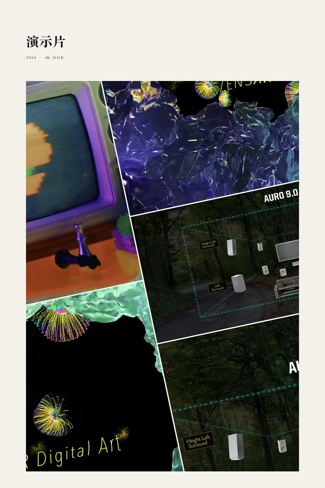
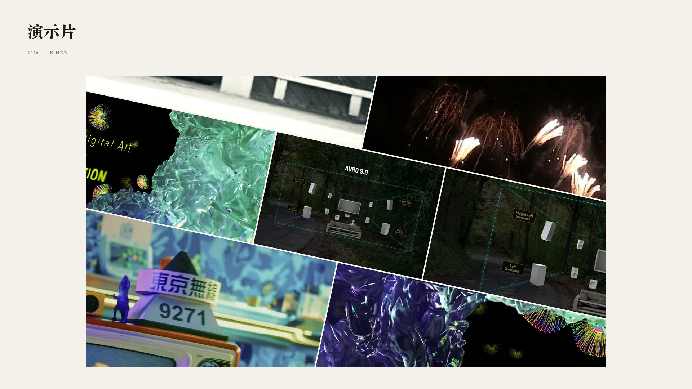

# MoviePilot 插件仓库（liujuncdb）

MoviePilot 插件市场仓库，当前包含 **2** 个插件。

## 插件列表

| 插件 | 版本 | 说明 |
| --- | --- | --- |
| 文件夹封面生成（FolderCover） | 0.1 | 扫描目录并批量生成 Emby 可识别的竖版 / 横版文件夹封面 |
| FFmpegStrm缩略图·中间帧魔改 | 2.1.2 | 按影片片长截取中间帧作为 STRM 缩略图 |

## 文件夹封面生成（FolderCover）v0.1

扫描指定目录及其子目录，为每个文件夹生成：

- `folder.jpg`：竖版 2:3，1000 × 1500
- `backdrop.jpg`：横版 16:9，1920 × 1080

素材优先取目录内已有的刮削图、海报、剧照和视频截图；缺图时可从视频中间帧补截。所有版式都在插件详情页实时预览，点图即选，支持目录树多选、四槽位分别设置、一键全量生成，以及默认 / 随机两套配色：默认保持版式原始底色，随机则为每个目录独立生成低饱和、同色系的纸面与深场，不复用预览配色。




### 版式

| 画幅 | 单图 | 多图 |
| --- | --- | --- |
| 竖版 2:3 | 画框、剧场、柔彩 | 叠片、网格、折页、斜拼 |
| 横版 16:9 | 影院宽幅、杂志跨页、留白横幅 | 层叠、胶片条、拼贴墙、斜拼 |

详细配置与使用说明见 [plugins.v3/foldercover/README.md](plugins.v3/foldercover/README.md)。

## FFmpegStrm缩略图·中间帧魔改 v2.1.2

基于 imaliang 的 FFmpegStrmThumb 改造：探测片长后按比例截取（默认正中间），短视频不再因固定时间点越界而失败；支持断点续跑、扫描互斥与进度日志。

详细说明见 [plugins.v3/ffmpegstrmthumbmid/README.md](plugins.v3/ffmpegstrmthumbmid/README.md)。

## 安装方式

在 MoviePilot 的插件市场设置或 `PLUGIN_MARKET` 中加入本仓库：

```text
liujuncdb/moviepilot-plugins
```

保存后进入插件市场，搜索「文件夹封面生成」或 `FFmpegStrm` 安装。本仓库发布新版本时，插件页会提示更新。

## 仓库结构

```text
package.v3.json                   V3 插件索引（版本、描述、更新历史）
package.json                      跨版本 / V2 兼容索引
icons/                            插件列表图标
plugins.v3/<插件id小写>/           V3 插件源码目录
plugins/<插件id小写>/              跨版本兼容源码目录
docs/                             预览图
scripts/check_release.py          发布前版本与语法检查
LICENSE                           GPL-3.0
NOTICE                            上游来源与致谢
```

索引字段遵循 MoviePilot 规范：`name / description / labels / version / icon / author / level / system_version / history`，`version` 与插件内的 `plugin_version` 保持一致，`history` 顶部为当前版本。

## 发布前检查

```bash
python3 scripts/check_release.py
```

检查项：插件目录名与主类名一致、索引版本与代码版本一致、`history` 顶部版本一致、图标存在、Python 语法编译通过。

## 许可

本仓库以 GNU General Public License v3.0 发布，详见 [LICENSE](LICENSE) 与 [NOTICE](NOTICE)。
