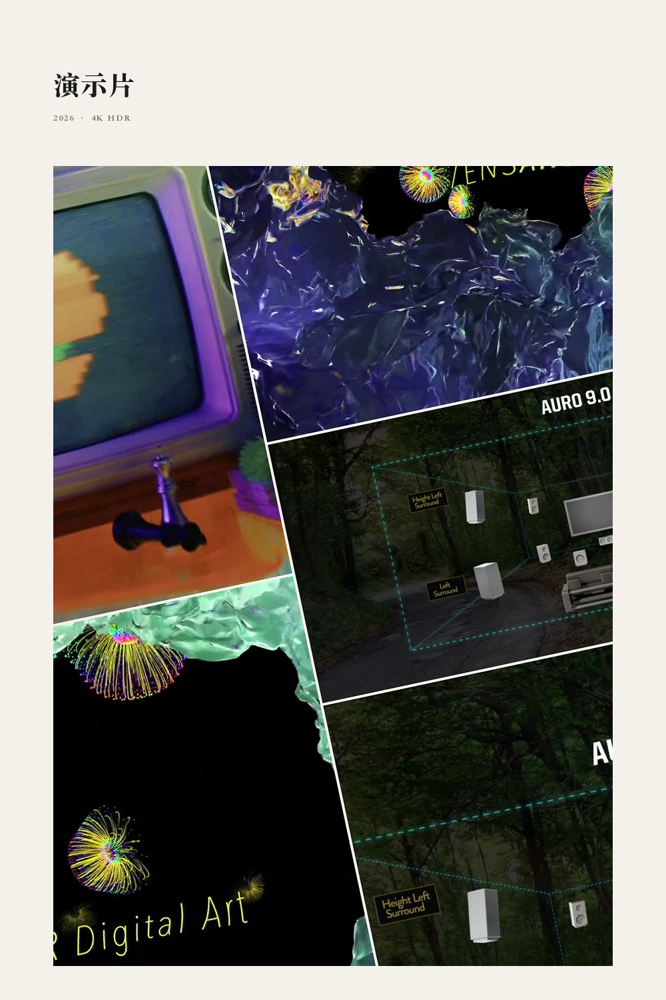
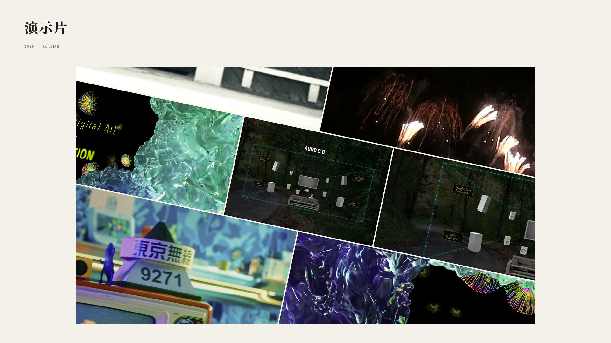

# 文件夹封面生成（FolderCover）

为媒体库目录批量生成本地封面，适用于 Emby、Jellyfin 等会读取 `folder.jpg` / `backdrop.jpg` 的媒体服务器。




## 能做什么

- 扫描指定目录及其子目录，每个目录独立生成一张封面
- 竖版 `folder.jpg`：1000 × 1500（2:3）
- 横版 `backdrop.jpg`：1920 × 1080（16:9）
- 素材取自目录内已有的海报、背景图、剧照、`-thumb.jpg` 视频截图；缺图时用 ffmpeg 从视频中间帧补截
- 14 套版式按「竖版 / 横版 × 单图 / 多图」四槽位分别选择
- 详情页内实时预览：目录树多选，当前画幅的全部风格同屏渲染，点图即选
- 支持一键全量生成、定时扫描、单目录重做
- 自动排除本插件自己生成的 `folder.jpg` / `backdrop.jpg`，并用 `.foldercover.json` 清单防止图片套娃

## 版式

| 画幅 | 单图 | 多图 |
| --- | --- | --- |
| 竖版 2:3 | 画框（装裱留白）、剧场（深底银幕）、柔彩（全彩渐变场） | 叠片（相纸叠放）、网格（接触印样）、折页（扇形铺开）、斜拼（斜网格拼贴） |
| 横版 16:9 | 影院宽幅（压暗底纹）、杂志跨页（图版 + 文字栏）、留白横幅（极简） | 层叠（右侧叠卡）、胶片条（一排画格）、拼贴墙（大图 + 三小图）、斜拼（斜网格拼贴） |

单图与多图可由「单图/多图判定」自动选择，也可强制全部使用单图或全部使用多图版式。

## 安装

### 插件市场

在 MoviePilot 的 `PLUGIN_MARKET` 中加入本仓库地址，重启后在插件市场搜索「文件夹封面生成」安装：

```text
https://github.com/liujuncdb/moviepilot-plugins
```

### 手动安装

把 `plugins/foldercover/` 整个目录复制到 MoviePilot 插件目录，然后重启：

```bash
# Docker 部署的常见路径
docker cp foldercover moviepilot:/app/app/plugins/foldercover
docker restart moviepilot
```

插件依赖 Pillow 与 ffmpeg。MoviePilot 镜像通常已包含两者；若缺图截帧失败，请确认容器内 `ffmpeg` 可执行。

## 配置项

设置页只放扫描范围、生成策略和输出开关；具体风格、标题文字和要重做的目录，都在详情页的「文件夹封面工作室」里操作。

| 配置 | 说明 |
| --- | --- |
| 启用插件 | 开启后按定时周期运行 |
| 立即运行一次 | 保存配置后立即执行一轮扫描 |
| 递归子目录 | 是否处理扫描目录下的所有子目录 |
| 扫描目录 | 每行一个绝对路径，例如 `/media/电影` |
| 排除目录 | 每行一个绝对路径，扫描时跳过 |
| 单图/多图判定 | `自动`：有子目录或多图时用多图版式；也可强制 `单图` / `多图` |
| 已有封面时 | `仅补缺失`：已有输出不重画；`跳过`：目录已有素材或封面则跳过；`覆盖`：重新合成并覆盖 |
| 生成 folder.jpg | 是否输出竖版封面 |
| 生成 backdrop.jpg | 是否输出横版封面 |
| 素材来源 | `刮削静帧优先`：先用目录内图片，缺图再截帧；`只用视频截图`：只用视频帧 |
| 封面显示标题 | 关闭后只放图，不叠加目录名 |
| 缺图时截视频帧 | 是否允许 ffmpeg 截帧兜底 |
| 定时扫描周期 | 5 位 cron 表达式，留空则关闭定时任务 |
| 生成策略 | `100=60` 表示每生成 100 个目录暂停 60 秒，降低连续读盘压力 |

## 使用流程

1. 在设置页填写扫描目录，打开「启用插件」，保存。
2. 打开插件详情页的「文件夹封面工作室」。
3. 左侧目录树勾选要处理的目录；右侧切换「竖版单图 / 竖版多图 / 横版单图 / 横版多图」四个槽位。
4. 当前槽位的所有版式会同时渲染，点选喜欢的版式。
5. 需要改标题时在预览区修改文字，预览会即时更新。
6. 点「应用到选中目录」生成；需要整库处理时用「一键全量」。

## 输出文件

每个被处理的目录会写入：

- `folder.jpg`（开启竖版输出时）
- `backdrop.jpg`（开启横版输出时）
- `.foldercover.json`：生成清单，记录输出文件与内容摘要，后续扫描会据此排除自己生成的成品

## 注意事项

- 扫描目录必须对 MoviePilot 容器可读；Docker 部署请确认媒体目录已正确挂载。
- 目录内没有可用图片、也没有可截帧的视频时，该目录会被跳过并记录日志。
- 视频截帧需要 ffmpeg；截帧失败不会中断其它目录。
- 生成封面会写入媒体目录，首次使用建议先在测试目录验证效果。
- 插件不会修改视频文件，只新增或覆盖上述封面与清单文件。

## 日志

插件日志位于 MoviePilot 日志目录下的 `plugins/foldercover.log`。
